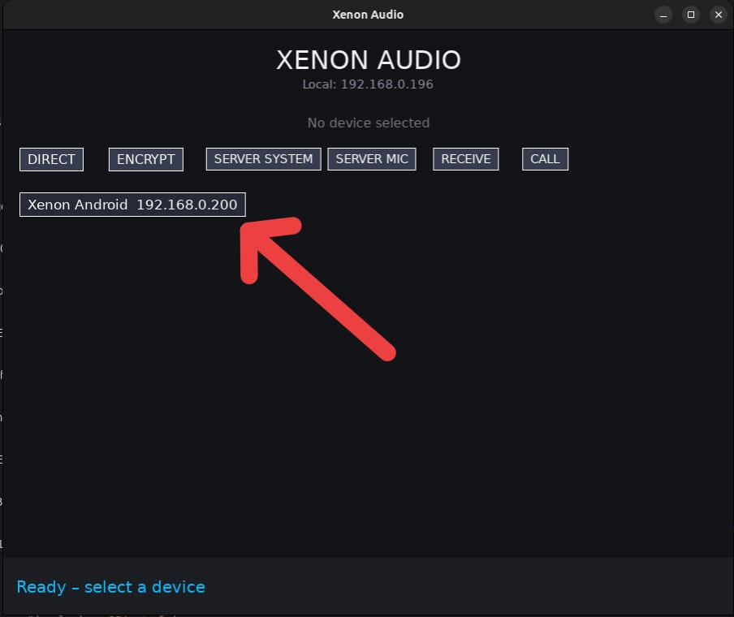
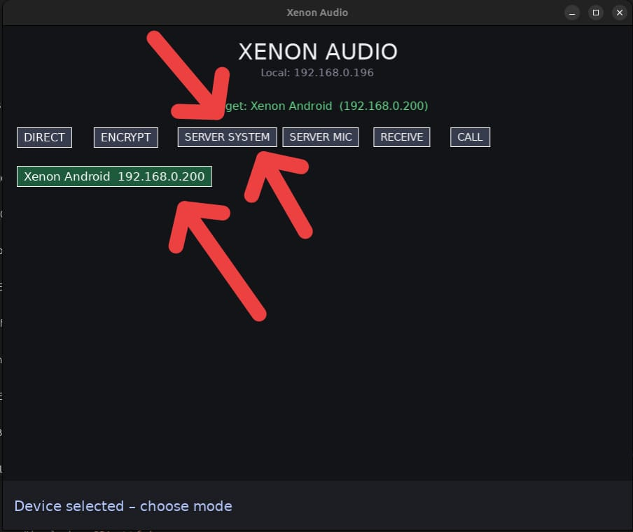
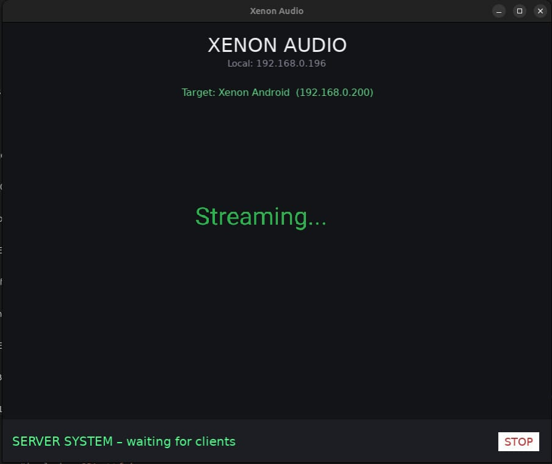
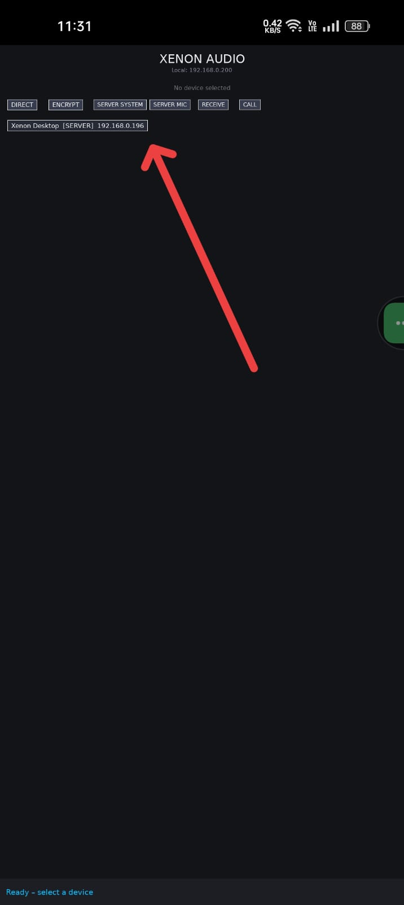
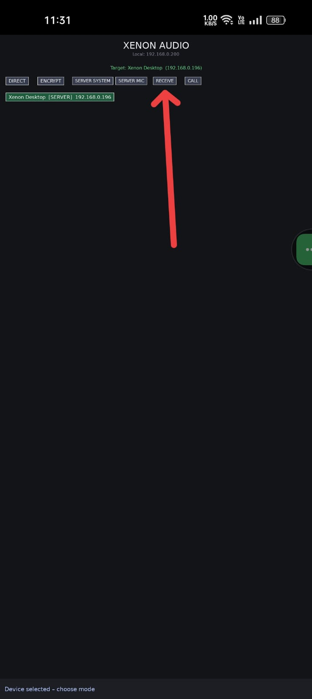
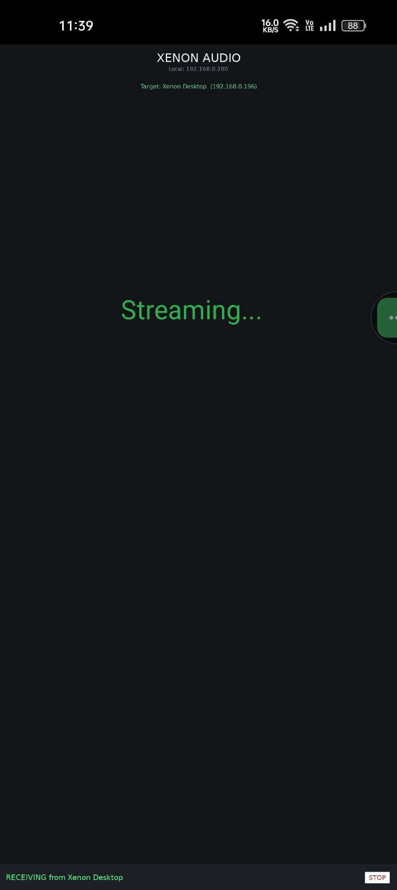

## Screenshots

 
<table>
  <tr>
    <td align="center">
       
      <b>Device Discovery</b>
    </td>
    <td align="center">
       
      <b>Select target device</b> 
      <b>and mode</b>
    </td>
    <td align="center">
       
      <b>Stream starts</b>
    </td>
  </tr>
  <tr>
    <td align="center">
       
      <b>Device Discovery</b>
    </td>
    <td align="center">
       
      <b>Select server and click Receive</b>
    </td>
    <td align="center">
       
      <b>Stream starts</b>
    </td>
  </tr>

</table>
